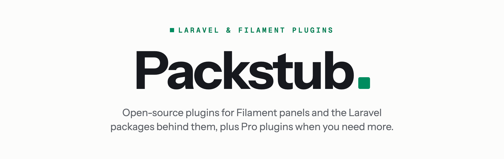

  <a href="https://packstub.dev">
    <picture>
      <source media="(max-width: 600px)" srcset="https://raw.githubusercontent.com/packstub/.github/main/profile/hero-mobile.png">
      
    </picture>
  </a>

  <a href="https://packstub.dev">packstub.dev</a> &middot;
  <a href="https://packstub.dev/docs">Docs</a> &middot;
  <a href="https://packstub.dev/guides">Guides</a> &middot;
  <a href="https://stats.packstub.dev">Download stats</a> &middot;
  <a href="https://xlite.dev">XLITE</a>

Plugins for [Filament](https://filamentphp.com) panels and the Laravel packages behind them, open source under MIT and installed from Packagist with `composer require`. When a project needs more, the Pro plugins install the same way, from Packstub's own Composer repository.

## Filament plugins

<table>
<tr>
<td width="50%" valign="top">

<b><a href="https://github.com/packstub/filament-agents">Filament Agents</a></b> 
An in-panel AI assistant and an MCP server from one tool list. 
<a href="https://packstub.dev/docs/filament-agents">Docs</a> &middot; <a href="https://filamentphp.com/plugins/packstub-agents">Directory</a> &middot; <a href="https://packagist.org/packages/packstub/filament-agents">Packagist</a>
</td>
<td width="50%" valign="top">

<b><a href="https://github.com/packstub/filament-session-replay">Filament Session Replay</a></b> 
Watch what users did in your panel, errors and rage clicks on the timeline. 
<a href="https://packstub.dev/docs/filament-session-replay">Docs</a> &middot; <a href="https://filamentphp.com/plugins/packstub-session-replay">Directory</a> &middot; <a href="https://packagist.org/packages/packstub/filament-session-replay">Packagist</a>
</td>
</tr>
<tr>
<td width="50%" valign="top">

<b><a href="https://github.com/packstub/filament-flow">Filament Flow</a></b> 
Workflow automation drawn on a canvas, run by your queue. 
<a href="https://packstub.dev/docs/filament-flow">Docs</a> &middot; <a href="https://filamentphp.com/plugins/packstub-flow">Directory</a> &middot; <a href="https://packagist.org/packages/packstub/filament-flow">Packagist</a>
</td>
<td width="50%" valign="top">

<b><a href="https://github.com/packstub/filament-form-builder">Filament Form Builder</a></b> 
Forms built in the admin, rendered with Blade, Livewire or JSON. 
<a href="https://packstub.dev/docs/filament-form-builder">Docs</a> &middot; <a href="https://filamentphp.com/plugins/packstub-form-builder">Directory</a> &middot; <a href="https://packagist.org/packages/packstub/filament-form-builder">Packagist</a>
</td>
</tr>
<tr>
<td width="50%" valign="top">

<b><a href="https://github.com/packstub/filament-account-switcher">Filament Account Switcher</a></b> 
Impersonation, linked sub-accounts and developer logins, with an audit log. 
<a href="https://packstub.dev/docs/filament-account-switcher">Docs</a> &middot; <a href="https://filamentphp.com/plugins/packstub-account-switcher">Directory</a> &middot; <a href="https://packagist.org/packages/packstub/filament-account-switcher">Packagist</a>
</td>
<td width="50%" valign="top">

<b><a href="https://github.com/packstub/filament-holler">Filament Holler</a></b> 
Audio, video and screen-share calls inside the panel, peer to peer over WebRTC. 
<a href="https://packstub.dev/docs/filament-holler">Docs</a> &middot; <a href="https://filamentphp.com/plugins/packstub-holler">Directory</a> &middot; <a href="https://packagist.org/packages/packstub/filament-holler">Packagist</a>
</td>
</tr>
<tr>
<td width="50%" valign="top">

<b><a href="https://github.com/packstub/filament-teams">Filament Teams</a></b> 
Teams, invitations, seat limits and tenant-scoped roles. 
<a href="https://packstub.dev/docs/filament-teams">Docs</a> &middot; <a href="https://filamentphp.com/plugins/packstub-teams">Directory</a> &middot; <a href="https://packagist.org/packages/packstub/filament-teams">Packagist</a>
</td>
<td width="50%" valign="top">

<b><a href="https://github.com/packstub/filament-features">Filament Features</a></b> 
Plans, limits and feature flags per tenant, with overrides and kill switches. 
<a href="https://packstub.dev/docs/filament-features">Docs</a> &middot; <a href="https://filamentphp.com/plugins/packstub-features">Directory</a> &middot; <a href="https://packagist.org/packages/packstub/filament-features">Packagist</a>
</td>
</tr>
<tr>
<td width="50%" valign="top">

<b><a href="https://github.com/packstub/filament-spreadsheet">Filament Spreadsheet</a></b> 
Edit hundreds of records like a spreadsheet, saved in one validated batch. 
<a href="https://packstub.dev/docs/filament-spreadsheet">Docs</a> &middot; <a href="https://filamentphp.com/plugins/packstub-spreadsheet">Directory</a> &middot; <a href="https://packagist.org/packages/packstub/filament-spreadsheet">Packagist</a>
</td>
<td width="50%" valign="top">

<b><a href="https://github.com/packstub/filament-gantt">Filament Gantt</a></b> 
A Gantt chart and resource timeline from any Eloquent query with a start and an end. 
<a href="https://packstub.dev/docs/filament-gantt">Docs</a> &middot; <a href="https://filamentphp.com/plugins/packstub-gantt">Directory</a> &middot; <a href="https://packagist.org/packages/packstub/filament-gantt">Packagist</a>
</td>
</tr>
<tr>
<td width="50%" valign="top">

<b><a href="https://github.com/packstub/filament-kanban">Filament Kanban</a></b> 
A fast board with optimistic drag and drop and per-user columns. 
<a href="https://packstub.dev/docs/filament-kanban">Docs</a> &middot; <a href="https://filamentphp.com/plugins/packstub-kanban">Directory</a> &middot; <a href="https://packagist.org/packages/packstub/filament-kanban">Packagist</a>
</td>
<td width="50%" valign="top">

<b><a href="https://github.com/packstub/filament-coedit">Filament Coedit</a></b> 
Edit records together without locks: live presence and field-by-field merges. 
<a href="https://packstub.dev/docs/filament-coedit">Docs</a> &middot; <a href="https://packagist.org/packages/packstub/filament-coedit">Packagist</a>
</td>
</tr>
<tr>
<td width="50%" valign="top">

<b><a href="https://github.com/packstub/filament-rating">Filament Rating</a></b> 
Star ratings as a field, column, entry and summarizer, half stars included. 
<a href="https://packstub.dev/docs/filament-rating">Docs</a> &middot; <a href="https://filamentphp.com/plugins/packstub-rating">Directory</a> &middot; <a href="https://packagist.org/packages/packstub/filament-rating">Packagist</a>
</td>
<td width="50%" valign="top">

<b><a href="https://github.com/packstub/filament-nitpick">Nitpick</a></b> 
Designed themes for Filament panels, with a per-user choice. 
<a href="https://packstub.dev/docs/filament-nitpick">Docs</a> &middot; <a href="https://filamentphp.com/plugins/packstub-nitpick">Directory</a> &middot; <a href="https://packagist.org/packages/packstub/filament-nitpick">Packagist</a>
</td>
</tr>
</table>

## Laravel packages

Each of these runs in a plain Laravel app on its own; most are the engines behind the Filament plugins of the same name.

- **[Agents for Laravel](https://github.com/packstub/agents)**: an agent engine and an MCP server sharing one tool list, with turns, budgets and limits. [Docs](https://packstub.dev/docs/agents) &middot; [Packagist](https://packagist.org/packages/packstub/agents)
- **[Session Replay for Laravel](https://github.com/packstub/session-replay)**: an rrweb recorder with privacy defaults, token-signed ingest, recordings on your own disk and database, a player behind a gate you define. [Docs](https://packstub.dev/docs/session-replay) &middot; [Packagist](https://packagist.org/packages/packstub/session-replay) &middot; [Demo app](https://github.com/packstub/session-replay-demo)
- **[Account Switcher for Laravel](https://github.com/packstub/account-switcher)**: impersonation, linked sub-accounts and developer logins without signing out, with an audit log. [Docs](https://packstub.dev/docs/account-switcher) &middot; [Packagist](https://packagist.org/packages/packstub/account-switcher)
- **[Holler for Laravel](https://github.com/packstub/holler)**: audio, video and screen-share calls between the users of an app, 1-on-1 or up to four, with polling signaling and no websockets. [Docs](https://packstub.dev/docs/holler) &middot; [Packagist](https://packagist.org/packages/packstub/holler) &middot; [holler-js](https://github.com/packstub/holler-js), its browser engine
- **[Credits](https://github.com/packstub/credits)**: credits and usage metering, with expiring credits, holds for AI calls, exact meters and plan allowances without a cron. [Docs](https://packstub.dev/docs/credits) &middot; [Packagist](https://packagist.org/packages/packstub/credits)
- **[Partisan](https://github.com/packstub/partisan)**: Artisan for Laravel packages, `make:` generators that write into `src/` with your package namespace. [Docs](https://packstub.dev/docs/partisan) &middot; [Packagist](https://packagist.org/packages/packstub/partisan)

## Starter kit

- **[Filament SaaS Starter](https://github.com/packstub/filament-saas-starter)**: a multi-tenant SaaS starter for Laravel and Filament with sign-up, workspaces, team invitations, plans with limits and Stripe billing, built on Filament Teams and Filament Features. [Packagist](https://packagist.org/packages/packstub/filament-saas-starter)

## Pro

For the projects that need more, with licensed updates and a customer portal that shows you exactly how to install.

<table>
<tr>
<td width="50%" valign="top">

<b><a href="https://packstub.dev/plugins/filament-tenancy">Filament Tenancy</a></b> 
One database per tenant, any number of database servers. Powered by stancl/tenancy. 
<a href="https://packstub.dev/plugins/filament-tenancy">Plugin page</a> &middot; <a href="https://packstub.dev/docs/filament-tenancy">Docs</a> &middot; <a href="https://filamentphp.com/plugins/packstub-tenancy">Directory</a> &middot; <a href="https://github.com/packstub/filament-tenancy-demo">Demo app</a>
</td>
<td width="50%" valign="top">
</td>
</tr>
</table>

## About the public mirrors in this org

The `*-mirror` repositories are provenance mirrors of the open-source packages Filament Tenancy builds on. The `mirror/*` tags are the exact trees served through our Composer repository, so you can audit precisely what you install. They are not development forks: all development happens upstream, and we are grateful to the maintainers of those projects.

## Get in touch

- Support: support@packstub.dev
- Made by [XLITE](https://xlite.dev); more open-source work at [@xlitedev](https://github.com/xlitedev) and [@reelson](https://github.com/reelson)
- Sponsor the open-source work: [github.com/sponsors/icaliman](https://github.com/sponsors/icaliman)
